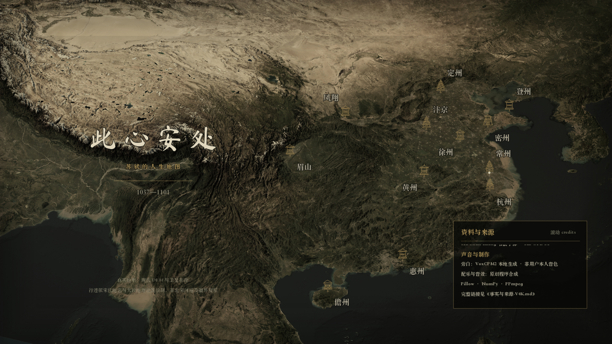

# 此心安处——苏轼的人生地图

一部以真实三维中国地形讲述苏轼一生的档案风纪录片。

从眉山出生，到常州人生终点，同一个主光点沿地理路径前行。地图、年号、历史画像、作品摘句与旁白共同构成一条 5 分 26 秒的人生行迹。



## 成片

- **V4K**：真正 3840×2160，24fps，7824 帧，326 秒。
- **声音**：29 段非用户音色旁白、56 条字幕，配原创程序合成音乐与音效。
- **结构**：3 秒独立片名、18 秒眉山出生与三苏出蜀、13 个正文行程章节。
- **版本**：V4K 使用升级后的真实 DEM 与卫星影像原生渲染，不是放大 1080p。

成片与分卷下载见 [GitHub Releases](https://github.com/NinJinHZ/sushi-life-map/releases)。

V4K 母版约 2.22GiB，因此以两个原字节分卷发布。下载同一 Release 中的两个分卷后合并：

```bash
cat sushi-life-map-V4K.mp4.part-aa sushi-life-map-V4K.mp4.part-ab > sushi-life-map-V4K.mp4
shasum -a 256 -c sushi-life-map-V4K.sha256
```

Release 同时提供较便于直接下载的 V3.1 1080p 版本与 V4K 字幕。

## 创作与制作

- 真实 Mapzen Terrarium DEM 高程、Esri World Imagery 卫星影像与 Blender 三维地形。
- 全国 zoom 9 数据为 28928×20480；四块地形合计 2,433,151 顶点。
- 从出生到人生终点顺叙，同一个主光点代表苏轼，不使用永久常亮路线或串珠足迹。
- 档案风细线画框、底部时间刻度、历史画像与克制信息层级。
- 收录《念奴娇·赤壁怀古》《定风波》《狱中寄子由二首·其一》《减字木兰花·己卯儋耳春词》等作品摘句。
- 使用 Blender、Pillow、NumPy 与 FFmpeg 制作。

## 仓库内容

- `sushi-terrain-source.oqDCpZ/`：地形、渲染、档案合成、配音、总装、编码与 QA 脚本。
- `sushi-terrain-test.ynv3ob/final-film/timeline.json`：章节、站点、事实与作品时间线。
- `projection-4k.json`：7320 帧正文摄影机、光点与地理标注投影。
- `final-film/audio/mix-pre-master.wav`：最终混音母带。
- `final-film/voice/`：旁白调度与制作音频。
- `final-film/qa-video-v4k/`：完整解码、规格、响度与抽帧检查记录。
- `成片/`：V4K 字幕、封面和完整事实与来源说明。

本地完整制作目录约 204GB。本仓库公开的是**制作代码、关键工程数据、最终音频、文档与校验证据**，不包含原始帧序列、分段编码缓存、批量地形瓦片、生成的 `.blend` 场景及仓库内重复 MP4。上述大文件保留在本地，可通过脚本与原始数据源重新生成；本仓库不是对 204GB 中间产物的镜像备份。

## 复现说明

制作环境为 macOS、Blender 5.2.2 LTS／EEVEE、Python 3、Pillow、NumPy 与 FFmpeg。部分系统字体路径和数据路径保留制作时的 macOS 形式，迁移到其他系统时需要调整。

这是一份实际制作工程记录，不是一键生成应用。数据规格、GPU 纹理分块、渲染顺序和验收方法见 [4K 制作方案](sushi-terrain-test.ynv3ob/final-film/4K制作方案.md)。

## 事实、来源与许可

史实口径、作品系年、公开参考资料、实景图片作者与许可、历史画像和字体来源，集中记录在 [事实与来源-V4K.md](成片/事实与来源-V4K.md)。第三方素材仍按各自许可使用，批量 DEM 与卫星缓存不随仓库再分发。

项目自身的统一开源许可证尚未单独指定。

## 校验边界

V4K 已通过完整音视频解码、帧数、规格、章节、字幕与响度检查，并查看了 16 个周期抽帧和 11 个编码后关键帧的接触表。这里没有声称逐帧连续人工观看或完成全片人耳试听。
